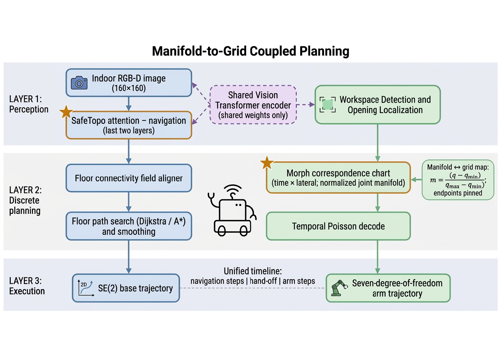
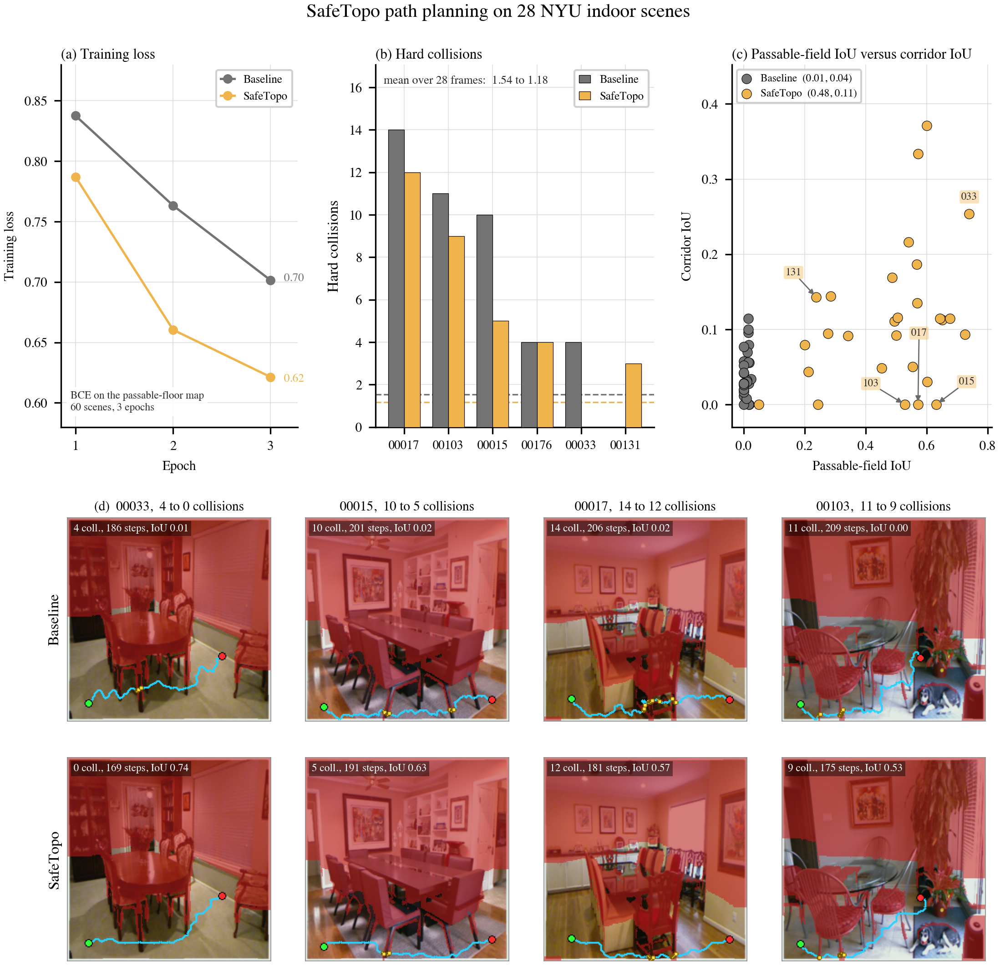
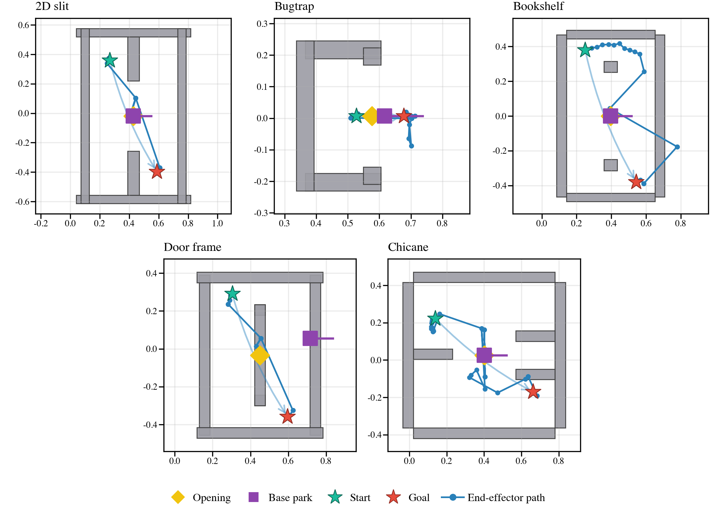
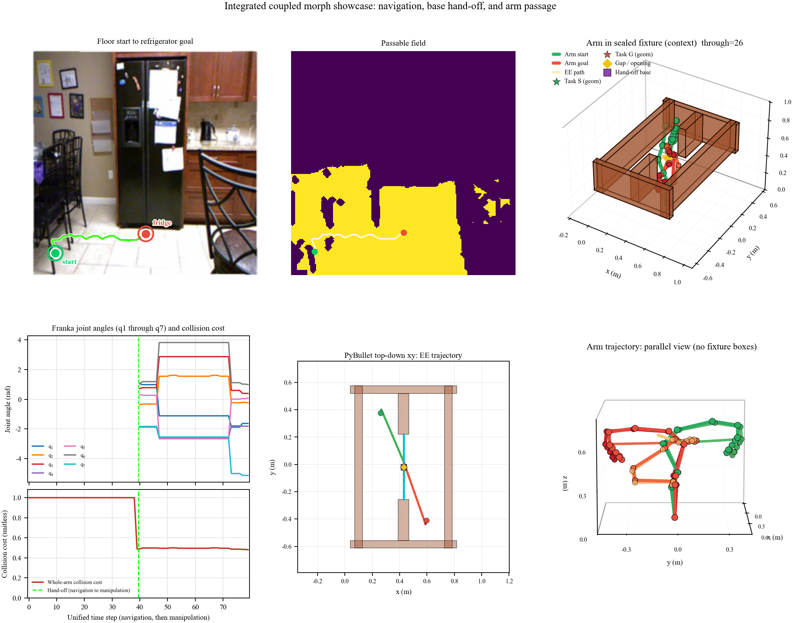

# Robot Moves and Plannings

[中文导读](README_zh.md)

**Companion repository** for *Manifold-to-Grid Coupled Planning with Vision Transformers* (under review).  
This project publishes **reusable planning modules** and plain-language documentation for:

1. **SafeTopo** — frozen ViT + geometry-aware attention for **indoor floor connectivity**  
2. **Morph** — opening-centered **time × lateral** chart for **7-DoF through-gap** motion  
3. **Coupled handoff** — park the mobile base, then run the arm on a **unified timeline**

> **No paper PDF**, full datasets, or training checkpoints are hosted here. Data provenance is documented in [DATA_SOURCES.md](DATA_SOURCES.md). Cite the paper when available via [CITATION.md](CITATION.md).

---

## Why two modules instead of one planner?

Navigation lives on a **2D floor grid** (\(SE(2)\)). Manipulation lives on a **7D torus** (\(\mathbb{T}^7\)). Merging them into one search space is expensive and brittle in narrow openings. The paper keeps a **shared ViT backbone** for perception but uses **different discrete planners**:

| Stage | Representation | Core idea |
|-------|----------------|-----------|
| Base | Passable probability map | SafeTopo Q/K injection + connectivity head |
| Arm | Chart `cell_q[T,W,7]` | Anchor at slit, color with PyBullet, decode with temporal Poisson |
| Coupled | Time index `t = 1…T_nav+T_arm` | Base reaches standoff → morph chart takes over |



Deep dives: [docs/safetopo.md](docs/safetopo.md) · [docs/morph.md](docs/morph.md) · [docs/coupled.md](docs/coupled.md)

---

## SafeTopo (navigation)

**Problem:** A vanilla ViT treats patches by **appearance**. Floors and furniture legs can look similar; connectivity is a **geometry** question.

**Mechanism:** For each patch, build eight depth features, expand to 32D harmonics, and write them into the **last 32 channels** of Q and K on the **final two** encoder layers (Value unchanged). A small `NavPatchConnectivityHead` predicts **per-patch floor passability** under BCE against a depth oracle. The backbone stays **frozen**; only the adapters and head train.

```python
# After install_safetopo_attention(...) and set_safetopo_tokens(depth)
# Forward pass yields vit_feat → NavPatchConnectivityHead → passable logits
pass_logits, _ = conn_head(vit_feat, img_h=224, img_w=224)
loss = F.binary_cross_entropy(torch.sigmoid(pass_logits), gt_passable)
```

**Planning:** Threshold the map → **8-neighbor Dijkstra** → smooth SE(2) waypoints. Eval collisions use an RGB-D **judge** that recovers thin obstacles (see `nav_floor_oracle.py`).



**Quick smoke test (no GPU weights):**

```bash
pip install -r requirements-safetopo.txt
python examples/safetopo_token_smoke.py
```

---

## Morph (manipulation through narrow openings)

**Problem:** Sampling in \(\mathbb{T}^7\) from start/goal chambers rarely finds the **thin** feasible set inside a slit.

**Mechanism (five steps):**

1. **Seeds** — Sample end-effector targets inside the opening; accept joint poses that are **whole-arm collision-free** in PyBullet.  
2. **Spine + funnel** — Fix the best seed at mid-time; blend neighbors over ~`T/8` steps so the arm tapers into the gap.  
3. **Lateral band** — For each time step, eleven workspace offsets (≈14 cm span) → local IK (`refine_q_toward_ee`, coordinate descent, **not** gradient-based global IK).  
4. **Coloring** — For each cell `(t,w)`, set `solid_mask[t,w]` if PyBullet or Detect voxels report collision (IK never checks obstacles).  
5. **Decode** — Temporal Poisson smoothing on manifold coords + snap each row to the nearest **free** column.

```text
cell_q.shape == (40, 11, 7)   # 440 joint candidates, not 440×7×6 stored tables
```



Morph files in `models/joint_morph_correspondence.py` and `models/joint_safetopo_decode.py` require **PyBullet scene code** from the full research tree—see [docs/MODULES.md](docs/MODULES.md).

---

## Coupled planning

The base follows the SafeTopo floor path to a **fixture standoff** facing the aperture. The arm chart is built in the **same world frame** as the parked base. Execution concatenates base and arm phases on one schedule.



Orchestration (`coupled_planner.py`, ViT-bridged runners) is documented in [docs/coupled.md](docs/coupled.md) and implemented in the research monorepo to avoid duplicating ViT+PyBullet load hygiene.

---

## Repository layout

```text
Robot-Moves-and-Plannings/
├── models/              # Vendored core modules (see MODULES.md)
├── docs/                # Method notes per pillar
├── assets/figures/      # PNG excerpts from paper visuals (no PDF)
├── examples/            # Minimal runnable checks
├── DATA_SOURCES.md      # NYU, ViT, PyBullet — what to download yourself
├── CITATION.md          # Bibtex placeholder (no PDF)
├── requirements-safetopo.txt
└── requirements-morph.txt
```

---

## Install

```bash
git clone https://github.com/Rayana-AD/Robot-Moves-and-Plannings.git
cd Robot-Moves-and-Plannings
pip install -r requirements-safetopo.txt   # navigation modules
# pip install -r requirements-morph.txt    # adds pybullet for arm collision utils
export PYTHONPATH="$(pwd)"
```

For end-to-end NYU training, sealed-family benchmarks, and coupled ViT runs, use the **research codebase** that produced the paper numbers (not mirrored here).

---

## License

MIT — see [LICENSE](LICENSE). Figures under `assets/figures/` are excerpts from the authors’ paper figures; reuse please cite the paper.

---

## Contact & contribution

Issues and PRs welcome for documentation clarity and module boundaries. For reproduction manifests (splits, seeds, checkpoint hashes) while the paper is under review, open a GitHub issue describing the table or figure you need to replicate.
