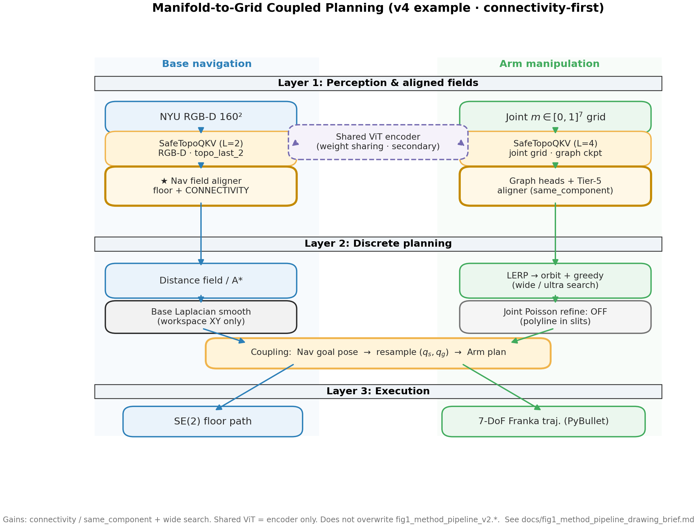
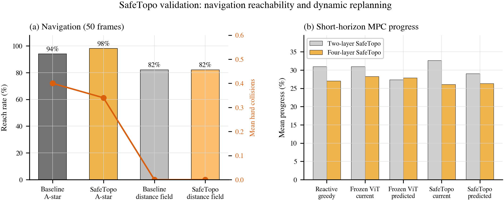
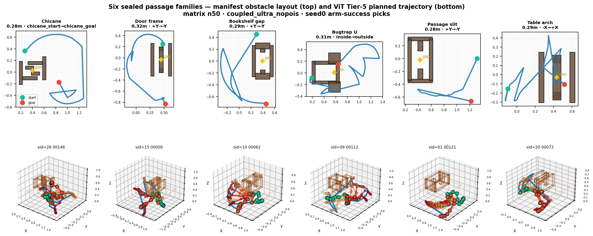
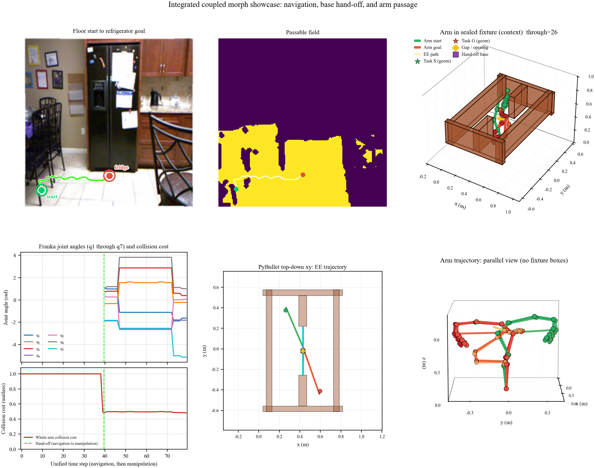

# Robot Moves and Plannings（中文导读）

论文《Manifold-to-Grid Coupled Planning with Vision Transformers》仍在审稿中。本仓库公开**可复用的规划模块**与说明文档，**不上传 PDF、完整数据集或训练权重**。数据来源见 [DATA_SOURCES.md](DATA_SOURCES.md)。

## 项目在解决什么问题？

移动操作需要两段能力：**底盘在地面找路**（低维 \(SE(2)\)）与 **7 轴机械臂穿狭窄开口**（高维 \(\mathbb{T}^7\)）。若在统一状态空间里暴力搜索，窄缝可行体积极小，极易死锁。本文采用 **共享冻结 ViT 做感知**，但 **导航与手臂使用不同的离散表示**：

| 模块 | 表示 | 核心方法 |
|------|------|----------|
| SafeTopo | 全图可走概率场 | 深度拓扑 token 注入 ViT 最后两层 Q/K + 连通小头 |
| Morph | `cell_q[40,11,7]` 候选表 | 以缝为中心建表，PyBullet 涂格，泊松时序平滑 |
| Coupled | 统一时间轴 | 底盘停稳对接开口 → 手臂解码图表 |



详细说明：[docs/safetopo.md](docs/safetopo.md) · [docs/morph.md](docs/morph.md) · [docs/coupled.md](docs/coupled.md)

---

## SafeTopo（导航）

**痛点：** 纯视觉 ViT 靠 RGB 相似度分组，易把桌腿当地面、把阴影当障碍。

**做法：** 每个 patch 从深度构造 8 维物理量，经零参数谐波扩成 32 维，替换每个注意力头 Q/K **末尾 32 通道**（\(\tau=2\) 缩放）。骨干冻结，只训练最后两层投影适配器与 `NavPatchConnectivityHead`。损失为全图 **二元交叉熵**，训练**不喂起点终点**，防止死记路线。

```python
loss = F.binary_cross_entropy(torch.sigmoid(pass_logits), gt_passable)
```

规划：可走图二值化 → **8 邻域 Dijkstra** → SE(2) 航向平滑。评测用 RGB-D **Oracle** 补细腿后逐点统计硬碰撞。



---

## Morph（穿缝手臂）

**痛点：** 从门外起终点在 7 维里盲搜，窄缝体积测度极小。

**五步流水线：**

1. **种子**：缝内采样手位 → 逆解 → PyBullet 验整臂无碰。  
2. **脊线 + 漏斗**：中点时刻钉种子，前后各约 `T/8` 步按 0.55×衰减系数混合，避免一步跳变撞框。  
3. **11 列横向带**：每时刻沿缝宽方向设手位，`refine_q_toward_ee` 做坐标轮换微调（约 6 轮外层迭代，**不**在 IK 里查碰）。  
4. **涂格**：对每个 `(t,w)` 用 PyBullet / Detect 标 `solid_mask`。  
5. **解码**：7 维流形坐标上时序泊松平滑 + 吸附到最近无碰列。

说明：表内存 **440 个 7 维关节向量**；「每关节 6 轮转」是填表时 IK 内部循环，不是表的额外维度。



完整 PyBullet 场景与 `joint_visible_passage` 仍在私人研究仓库，见 [docs/MODULES.md](docs/MODULES.md)。

---

## 耦合规划

底盘沿 SafeTopo 路径停靠开口正前方，与世界系中的障碍、缝几何对齐后，再构建 Morph 表并执行。论文 Fig. 1 第三层为统一时间轴上的 SE(2) 与关节轨迹拼接。



---

## 演示视频

仓库内**不提交**大体积 mp4。请将成片上传至视频平台后，在 [README.md](README.md) 中替换 YouTube 占位链接。

| 内容 | 研究仓库内本地路径（供剪辑上传） |
|------|----------------------------------|
| 五类密封缝 Morph | `videos/morph_five_families_linked.mp4` |
| 耦合厨房审片 | `results/demo_video/cv_review/coupled_planning_review.mp4` |

---

## 快速开始

```bash
git clone https://github.com/Rayana-AD/Robot-Moves-and-Plannings.git
cd Robot-Moves-and-Plannings
pip install -r requirements-safetopo.txt
export PYTHONPATH="$(pwd)"
python examples/safetopo_token_smoke.py
```

英文主 README：[README.md](README.md)
