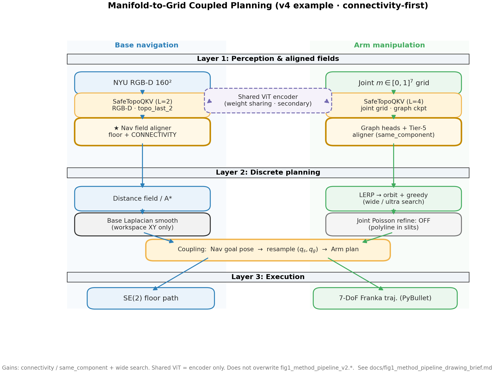

# Coupled execution: park the base, then morph through the opening

Coupled planning chains **2D floor navigation** and **7-DoF morph** on a **single timeline**: base motion occupies early indices, arm motion later indices, with a shared frozen ViT for perception where configured.

## Three layers (paper Fig. 1)

1. **Perception / alignment** — SafeTopo passable field; workspace opening detection for the arm chart.  
2. **Discrete planning** — Dijkstra on the floor grid; build and decode the \(T\times W\) morph chart.  
3. **Execution** — SE(2) base waypoints + joint trajectory under one schedule.

## Spatial handoff

The mobile base must **park** at a standoff facing the fixture so that:

- Start / goal joint seeds `q_s`, `q_g` are valid in the **same** world frame as PyBullet obstacles.  
- The morph chart’s opening anchor aligns with the detected aperture.

Coupled scripts in the research repo (`coupled_planner.py`, `coupled_vit_pipeline.py`) map floor pixels to workspace bounds and trigger `build_morph_chart` after nav succeeds.

## What this public repo includes

- Algorithm modules for **SafeTopo** and **Morph** (see `models/`).  
- Coupled **orchestration** and ViT-bridged benchmarks are documented here but implemented in the research tree to avoid duplicating heavy PyBullet + ViT load paths.

## Representative results

| Asset | Description |
|-------|-------------|
| `assets/figures/fig_showcase_coupled_morph_00090_kitchen_v7.png` | NYU kitchen frame: floor path + through-opening arm |
| `assets/figures/fig5_coupled_matrix_family.png` | Five sealed families after base handoff |

Record-based Table-style audits (`context-audit` skill in research repo) replay stored JSON without reloading ViT.
