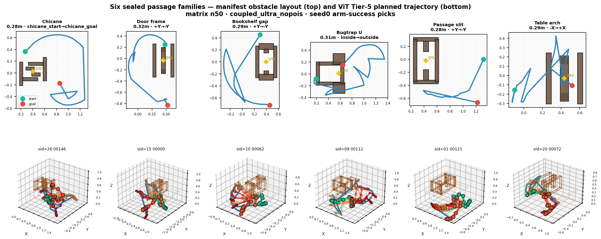

# Morph: opening-centered time–lateral chart for 7-DoF arms

Morph solves **through-aperture** manipulation without blind 7D sampling (RRT/PRM) from chamber endpoints. It anchors motion at the **bottleneck opening**, builds a **2D chart** (time × lateral offset), colors cells with collision labels, and extracts a smooth joint path.

## Chart semantics

| Symbol | Default | Meaning |
|--------|---------|---------|
| `T` | 40 | Progress from start chamber → slit → goal chamber |
| `W` | 11 | Lateral hand offsets across the slit (center column = spine) |
| `cell_q[t,w]` | 7 floats | Joint angles (rad) for that candidate |
| `cell_m[t,w]` | 7 in \([0,1]\) | Same pose in normalized manifold coords (for smoothing) |

**Not** \(40 \times 11 \times 7 \times 6\): the “6 rotation rounds” are **inner iterations** of coordinate-descent IK (`refine_q_toward_ee`); the table stores **one** `q` per cell.

## Pipeline order

```
1. search_opening_manifold_seeds   → EE in opening AABB + whole-arm free (PyBullet)
2. Pin spine at t=T//2, funnel-blend neighbors (decay over ~T/8 steps, mix ≤0.55)
3. lateral_band_q                  → 11 workspace targets per t, local IK
4. color_band_whole_arm            → solid_mask[t,w] via contact + Detect voxels
5. plan_on_joint_manifold_poisson  → temporal smooth + _snap_cols_path to free cells
```

### Funnel (time continuity)

At mid-time `t_mid`, replace spine pose with the best seed. For `dt = 1 … T/8`:

\[
q_{t_{mid}-dt} \leftarrow (1 - 0.55\alpha)\, q_{t_{mid}-dt} + 0.55\alpha\, q_{seed},\quad \alpha = 1 - dt/(T/8)
\]

(and symmetrically after the midpoint). This tapers the arm **before** the slit so a single-step jump does not scrape the frame.

### Collision is posterior, not inside IK

`refine_q_toward_ee` only minimizes end-effector distance. **PyBullet** (`collision_cost_q`, `check_self_collision`) and **OpeningDetectField** labels run in `color_band_whole_arm` and set `solid_mask[t,w]=True` for bad cells.

```python
# Per-cell check (simplified)
q = cell_q[t, w]
arm_hit = env.check_self_collision(q) or collision_cost_q(q, env, obstacles) >= 0.5
if arm_hit:
    solid_mask[t, w] = True
```

### Why a grid if PyBullet already knows geometry?

PyBullet answers **one** configuration at a time. The chart supplies **time structure**, **lateral redundancy** (11 choices per step), and a **discrete** path for Poisson smoothing with fixed `q_s` / `q_g`. That is the manifold-to-grid step: constrain search to a doorway-shaped sheet instead of \(\mathbb{T}^7\).

## Key entry points in this repo

| File | Purpose |
|------|---------|
| `models/joint_morph_correspondence.py` | Seeds, spine, `lateral_band_q`, chart build |
| `models/joint_safetopo_decode.py` | `plan_on_joint_manifold_poisson`, `_snap_cols_path` |

**Additional dependencies** (PyBullet env, Detect field, `joint_planner`, `joint_visible_passage`) remain in the full research codebase—import those modules or install the research repo as a sibling package.

## Representative result


