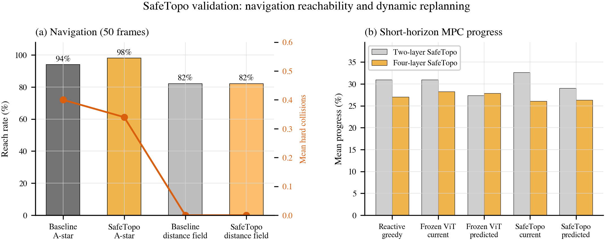

# SafeTopo: floor connectivity on a frozen ViT

SafeTopo (**Safe** topological injection into ViT **Topo**logy-aware **Q/K** attention) answers one question: *where is the floor connected enough to walk?* It does **not** memorize routes from start to goal.

## Idea in one paragraph

A standard ViT compares patches by RGB appearance. Indoor floors often look alike while obstacles (legs, shadows) break connectivity. SafeTopo keeps the pre-trained visual channels in each attention head and **replaces only the last `topo_dim` channels** (default 32) of **Query** and **Key** with geometry tokens derived from aligned depth. The dot product becomes visual similarity plus a geometric term; **Value** vectors stay unchanged so semantic features from the frozen backbone still flow through.

## Geometry tokens (8 → 32, no extra weights)

From each depth patch we build eight normalized channels: plane coordinates, smoothed depth gradients, gradient direction \((\cos\theta,\sin\theta)\), a floor proxy, and an obstacle proxy. They are expanded to 32 dimensions with deterministic harmonics (linear, signed square, \(\sin\pi v\), \(\cos\pi v\))—see `_expand_topology_features` in `models/safe_topo_qkv.py`.

```python
# Conceptual injection (see install_safetopo_attention + forward wrapper)
query_layer[:, heads, :, -topo_dim:] = scaled_topology_for_q
key_layer[:, heads, :, -topo_dim:]   = scaled_topology_for_k
# Attn scores: Q_vis K_vis^T + tau^2 T_Q T_K^T  (tau=2.0 default)
```

**Head split (navigation):** heads 0–3 (broad floor), 4–7 (height edges), 8–11 (narrow corridors)—configured when installing wrappers on the last two encoder layers.

## What is trained

| Module | `requires_grad` | Role |
|--------|-----------------|------|
| ViT-Base backbone | **False** | Frozen ImageNet features |
| Last-2 SafeTopo projection adapters | **True** | Map geometry into Q/K tail |
| `NavPatchConnectivityHead` | **True** | Patch tokens → dense passable logits |

Loss: **binary cross-entropy** on the full-image passable map vs depth-oracle GT (`NavPatchConnectivityHead` + `nav_patch_connectivity.py`). Optimizer: **AdamW** (`lr=1e-4`, `weight_decay=1e-4`), typically 3 epochs on 60 NYU scenes.

## Discrete planning (after the network)

1. Sigmoid passable map → 8-connected **Dijkstra** on the floor grid.  
2. Optional **floor-hug** soft cost and start/goal threshold repair (engineering heuristics, not the core method).  
3. Laplacian / chord smoothing for SE(2) base waypoints.

Eval uses an **RGB-D occupancy judge** (thin legs recovered from RGB–depth consistency) to score hard collisions **after** planning—see `nav_floor_oracle.py`.

## Key entry points in this repo

| File | Purpose |
|------|---------|
| `models/safe_topo_qkv.py` | Token build, wrapper install, `set_safetopo_tokens` |
| `models/nav_patch_connectivity.py` | `NavPatchConnectivityHead`, patch GT helpers |
| `models/nav_floor_oracle.py` | Train/eval traversable oracle from depth (+ optional RGB) |
| `models/joint_cspace_connectivity.py` | Shared BCE / connectivity utilities |

Full training and 28-scene eval scripts live in the private research repository (`train_nav_clean_connectivity.py`, `run_nav_clean_eval.py`).

## Representative result



*Traversable IoU and hard-collision means on 28 NYU eval scenes (paper Fig. 2 style).*
